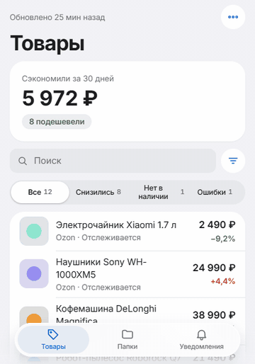
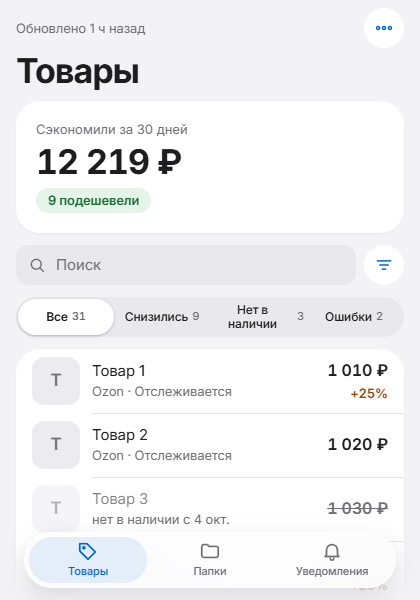
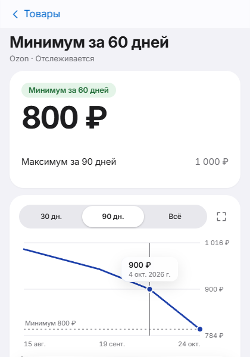
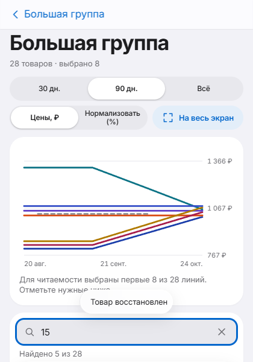

# Price Tracker for Ozon, Wildberries & Yandex Market

Chrome extension (Manifest V3) that tracks prices on Ozon, Wildberries and Yandex Market. All data stays in the browser: no server, no account.

<p align="center"></p>

| List | Product | Group chart |
|---|---|---|
|  |  |  |

## Features
- Price history per product with a 30 / 90 / all-time chart, scrubbing to the exact date and price.
- Folders with a group chart: search by name or ID, select matching, fullscreen.
- Unavailable products are detected from explicit marketplace signals and confirmed on 2 consecutive checks. No fake price points are written; the last real price is shown muted with its date.
- Target price alerts, "60-day low" only when the history really covers 60 days, savings over the last 30 days computed from stored history.
- Light/dark theme, Russian and English, keyboard navigation, `prefers-reduced-motion`, `prefers-reduced-transparency` and `prefers-contrast` supported.
- Export / import of all data as JSON.

## How it works
- Service worker (`assets/background.js`) schedules checks with `chrome.alarms`, parses pages (fetch or an offscreen document) and stores data in IndexedDB (`products`, `priceHistory`, `folders`).
- One content script per marketplace reads the live page price.
- The popup is a plain ES-module app (`assets/popup.js`) with no framework. All colors, sizes and timings live in `assets/tokens.css`; motion uses critically damped springs (`assets/motion.js`) that can be interrupted without a jump.
- Inter is bundled locally (OFL license); no remote code or fonts.

Permissions: `alarms`, `notifications`, `storage`, `scripting`, `offscreen`.

## Tests
Dev-only, in `tests/`. They launch a real Chromium with the unpacked extension and serve saved marketplace pages from a local HTTPS server.

```bash
cd tests && npm install
node parsers.mjs
node availability-flow.mjs
node ui.mjs
node demo-gif.mjs   # re-records docs/demo.gif with seeded demo data (needs ffmpeg)
```

Ozon serves an anti-bot challenge to automated clients, so its fixtures are synthetic; Wildberries and Yandex Market fixtures are saved real pages.

## Install (development)
`chrome://extensions` → Developer mode → Load unpacked → select this folder.

## License
MIT. See [LICENSE](LICENSE). The bundled Inter font is under the SIL Open Font License (`assets/fonts/Inter-OFL.txt`).
