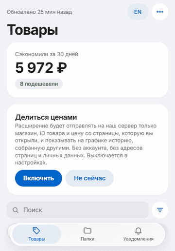
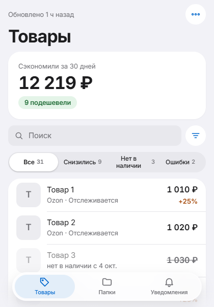
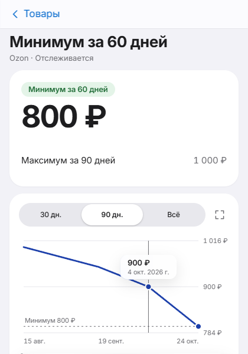
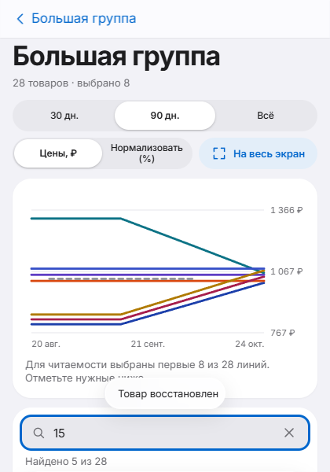
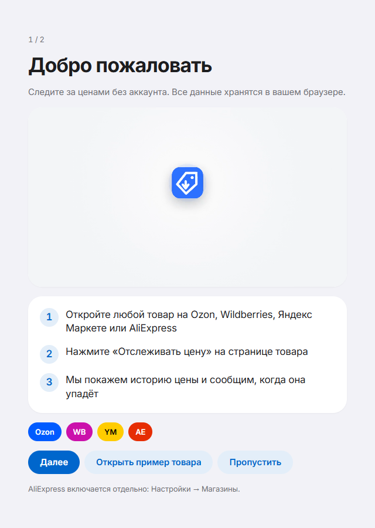
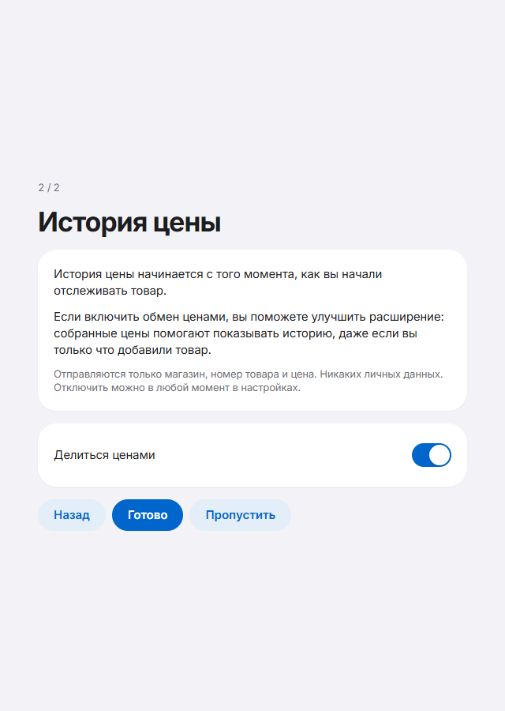
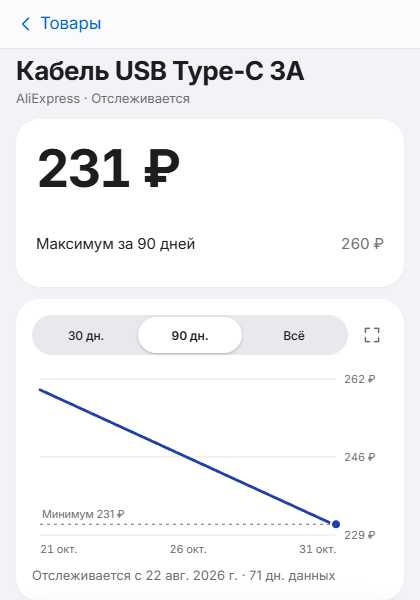
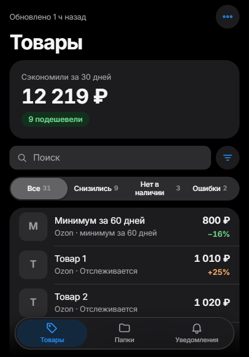
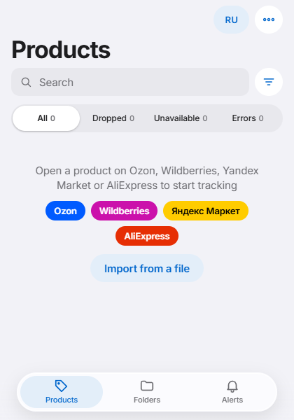
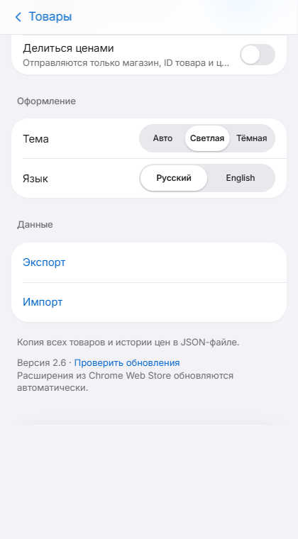

# Price Tracker for Ozon, Wildberries, Yandex Market & AliExpress

A free Chrome extension that tracks prices and shows price history charts on Ozon, Wildberries, Yandex Market and AliExpress Russia. Open any product page, see how its price has changed, and decide whether today's price is actually a discount.

Расширение для Chrome, которое отслеживает цены и показывает историю цен на Ozon, Wildberries, Яндекс Маркете и AliExpress. Откройте страницу товара и посмотрите, как менялась цена, чтобы понять, правда ли скидка настоящая.

[Install from the Chrome Web Store](https://chromewebstore.google.com/detail/dodppojnnlcmbjeenenmpalmiikkmfkh) | [Website](https://deyintelligence.com)

<p align="center"></p>

| List | Product | Group chart |
|---|---|---|
|  |  |  |

## What it does

Online marketplaces change prices often, and a "50% off" label does not tell you what the price was last week. This extension saves the prices of products you follow and plots them on a chart, so you can compare today's price with the recent past before you buy.

It works on four marketplaces:

- Ozon (ozon.ru)
- Wildberries (wildberries.ru)
- Yandex Market (market.yandex.ru)
- AliExpress Russia (aliexpress.ru), optional: the browser asks for access only when you press "Включить AliExpress"

## Features

- Price history charts for every tracked product (30 days, 90 days or all time), with scrubbing to the exact date and price
- Price-drop alerts: a target price per product, a drop by a chosen percentage, a new low, and back in stock
- Folders to organize tracked products
- Group charts that compare several products on one graph, with a filter and a fullscreen button
- Regular price toggle, so you can see the price without the loyalty discount
- "Нет в наличии" status for products that are out of stock; the last real price stays visible, greyed out with its date
- AliExpress variants (color, size): every variant has its own price history
- "Share prices" (optional, off by default): the chart can show price history collected from other users, even for a product you have just added
- Light and dark theme, Russian and English with a one-tap EN / RU button, keyboard navigation
- Export and import of all data as JSON
- Works inside your browser, with no separate app to open and no account

<p align="center"></p>

| Welcome, step 1 | Welcome, step 2 | AliExpress variant |
|---|---|---|
|  |  |  |

| Dark theme | English interface | Settings |
|---|---|---|
|  |  |  |

## Install

### From the Chrome Web Store

1. Open the [extension page](https://chromewebstore.google.com/detail/dodppojnnlcmbjeenenmpalmiikkmfkh).
2. Click "Add to Chrome".
3. Open a product on Ozon, Wildberries, Yandex Market or AliExpress and click the extension icon.

### From source

1. Clone this repository:
   ```bash
   git clone https://github.com/dev-kleo/price-tracker.git
   ```
2. Open `chrome://extensions` in Chrome.
3. Turn on Developer mode.
4. Click "Load unpacked" and select the project folder.

## How to use

1. Go to a product page on a supported marketplace.
2. Click the extension icon to start tracking the product.
3. Come back later to see the price chart and how the price has moved.
4. Put related products in a folder and open the group chart to compare them.

## Privacy

- Your tracked products, folders, history and settings stay in your browser.
- "Share prices" is off until you turn it on (welcome page or Settings). When on, the extension sends only three values from a product page you open: the store, the product ID and the price. No account, no page addresses, no personal data. The server receives your IP address but does not store it.
- The shared data is stored in Yandex Cloud (YDB), Russia. It is not sold and not used for ads. Turning the switch off stops all sending.
- Permissions: `alarms`, `notifications`, `storage`, `scripting`, `offscreen`. AliExpress access is an optional permission requested only on your action.

## FAQ

### How do I track a price on Ozon?

Install the extension, open the product page on ozon.ru, and add the product to your tracked list. The chart grows as prices are recorded.

### Can I see Wildberries price history?

Yes. The same steps work on wildberries.ru.

### Does it work with Yandex Market?

Yes, product pages on market.yandex.ru are supported.

### Does it work with AliExpress?

Yes, on aliexpress.ru. Enable it once from the extension menu or Settings; the browser then asks for access to that site. The price of the selected variant is tracked.

### Is it free?

Yes, the extension is free.

### Which browsers does it support?

Google Chrome. Other Chromium browsers that can install Chrome extensions, such as Edge and Yandex Browser, may also work.

## Palert alternative: how this extension compares

[Palert](https://palert.ru) is another free Chrome extension for tracking marketplace prices. If you are comparing the two, here is what each one offers, based on their public store descriptions.

| | This extension | Palert |
|---|---|---|
| Price | Free | Free |
| Ozon | Yes | Yes |
| Wildberries | Yes | Yes |
| Yandex Market | Yes | Yes |
| AliExpress Russia | Yes (optional) | Not mentioned in the store listing |
| Lamoda | No | Yes |
| Price history chart | Yes | Yes |
| Stock level dynamics | No | Yes, where the marketplace shares the data |
| Similar products search | No | Yes |
| Folders for tracked products | Yes | Not mentioned in the store listing |
| Group charts comparing several products | Yes | Not mentioned in the store listing |
| Regular price toggle | Yes | Not mentioned in the store listing |

Palert is a good fit if you want stock levels, analogue search or Lamoda coverage. This extension is built around organizing the products you follow and comparing them on one chart. Both are free, so you can install both and keep the one you prefer.

This project is independent and not affiliated with Palert. Feature lists change, so check each store page for current details.

Ищете альтернативу Palert? Это расширение тоже бесплатное и работает с Ozon, Wildberries, Яндекс Маркетом и AliExpress. Его отличие в папках для товаров и групповых графиках, на которых можно сравнить несколько товаров сразу.

## Русский

### Как отслеживать цены на Ozon, Wildberries, Яндекс Маркете и AliExpress

1. Установите расширение из Chrome Web Store.
2. Откройте страницу товара на ozon.ru, wildberries.ru, market.yandex.ru или aliexpress.ru.
3. Нажмите на значок расширения, чтобы добавить товар в список.
4. Смотрите график цены и сравнивайте товары в папках и групповых графиках.

### Возможности

- График истории цен для каждого товара
- Уведомления о снижении цены и о новом минимуме
- Папки для организации товаров
- Групповые графики для сравнения нескольких товаров
- Переключатель обычной цены (без скидки по карте)
- Статус «Нет в наличии» для товаров, которых нет в продаже
- AliExpress: у каждого варианта товара своя история цены
- «Делиться ценами» (по желанию, выключено по умолчанию): график показывает историю, собранную другими пользователями
- Светлая и тёмная тема, русский и английский язык, кнопка EN / RU в шапке

## How it works

- The service worker (`assets/background.js`) schedules checks with `chrome.alarms`, parses pages (fetch or an offscreen document) and stores data in IndexedDB (`products`, `priceHistory`, `folders`).
- One content script per marketplace reads the live page price.
- The popup is a plain ES-module app (`assets/popup.js`) with no framework. All colors, sizes and timings live in `assets/tokens.css`; motion uses critically damped springs (`assets/motion.js`).
- Inter is bundled locally (OFL license); no remote code or fonts.

## Tests

Dev-only, in `tests/`. They launch a real Chromium with the unpacked extension and serve saved marketplace pages from a local HTTPS server.

```bash
cd tests && npm install
node parsers.mjs
node availability-flow.mjs
node aliexpress.mjs
node shared-history.mjs
node ui.mjs
node demo-gif.mjs      # re-records docs/demo.gif with seeded demo data (needs ffmpeg)
node readme-shots.mjs  # re-records the welcome and Settings screenshots
```

Ozon serves an anti-bot challenge to automated clients, so its fixtures are synthetic; Wildberries and Yandex Market fixtures are saved real pages.

## Contributing

Pull requests are welcome. For larger changes, open an issue first so we can talk through the idea. Ideas and bug reports are welcome in the [issues](../../issues).

## Author

Built by Abhishek Dey (Cleo). More at [deyintelligence.com](https://deyintelligence.com) and [github.com/dev-kleo](https://github.com/dev-kleo).

## License

MIT. See [LICENSE](LICENSE). The bundled Inter font is under the SIL Open Font License (`assets/fonts/Inter-OFL.txt`).
