  

  I build software tools that people can run and check: retrieval-based assistants, browser extensions and web apps. 
  <a href="https://deyintelligence.com"><b>deyintelligence.com</b></a>

## Interests

- **Economics and international business**: how information and prices reach decision makers.
- **Retrieval-augmented generation for universities**: answers grounded in official documents, with citations and a refusal when retrieval is weak.
- **Browser tooling** that keeps user data local.

## Selected projects

<table>
  <tr>
    <td></td>
    <td></td>
  </tr>
  <tr>
    <td></td>
    <td></td>
  </tr>
</table>

## Stack

Open to research supervision and software roles. Reach me through <a href="https://deyintelligence.com">deyintelligence.com</a>.

